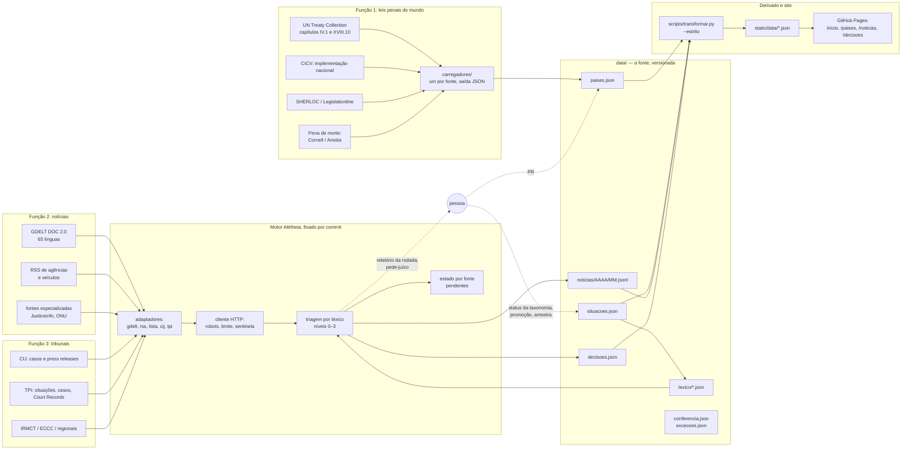

# 04 — Arquitetura

## Princípios

1. **Sem servidor, sem banco.** Tudo é arquivo de texto versionado e site estático, como
   no AtlasPen e no Alétheia. O custo fixo é zero e nada precisa ficar ligado.
2. **Um motor, três configurações.** As funções 2 e 3 rodam sobre o motor do Alétheia
   (contrato de adaptador, cliente HTTP educado, triagem por léxico, estado com
   pendentes, saídas JSONL). A função 1 não tem *crawler*: tem um **carregador** por
   fonte global e um validador.
3. **O robô propõe, a pessoa decide o que muda status.** O robô grava notícia e
   andamento; a mudança de status na taxonomia (medida provisória, mérito) e a
   promoção de um registro exigem commit humano.
4. **Fonte secundária aponta, não escreve.** Wikipedia, Wikidata e agregadores servem
   para achar o que falta e abrir pergunta; nunca preenchem campo.
5. **Toda rodada deixa rastro.** Relatório em dois tamanhos, `rodada.json` com código
   de saída, estado gravado mesmo quando a fonte falha.

## Visão geral

## Os robôs

| Robô | Função | O que faz | Herança | Agendamento |
|---|---|---|---|---|
| **Tabelião** | 1 | lê o **XML por tratado** da UN Treaty Collection (IV.1 e XVIII.10, verificado em `02-fontes.md`) e grava `convencao_1948` e `estatuto_roma` de cada país, com data, tipo, reservas e retiradas; acusa país novo, retirada e reserva nova | adaptador `lista` do Argos (tabela que muda devagar; linha alterada volta a ser lida) | mensal |
| **Cartógrafo** | 1 | a sondagem mostrou que **não há base aberta viva** de códigos penais: na fase 1 o Cartógrafo só reconfere, todo mês, se Legislationline, SHERLOC, Library of Congress e WorldLII voltaram a responder, e reabre a fonte em `fontes.json` quando sim; `codigo_penal` e `genocidio_interno` entram por carga humana | Cotejador do AtlasPen ("só pergunta") | mensal |
| **Sentenciador** (nome a decidir, D15) | 1 | lê a classificação de pena de morte no espelho do Cornell e propõe `pena_de_morte`; o anexo anual da Anistia entra à mão | `lista` | semanal (Cornell atualiza às quartas) |
| **Vigia das notícias** | 2 | `aletheia rodar` com `config/noticias.json`: GDELT por língua (`sourcelang:` × termos) e por tema (`WB_2509_GENOCIDE`), a 1 requisição por 5 s; ReliefWeb por `appname`; ~15 *feeds* RSS (lista em `02-fontes.md`); lê a página do veículo para triar, **exceto nos domínios com *opt-out* de mineração de texto**, onde tria só pelo *feed* e marca `sem_texto_por_politica`; grava nível ≥ 2 em `noticias/`, conta nível 0–1 no relatório | Alétheia inteiro + adaptador `reliefweb` novo | semanal (diário na fase de calibração) |
| **Escrivão** | 3 | adaptador `cij` (`lista` sobre página de caso e lista de *press releases*; PDF só como URL), `rss` do TPI (registros e notícias), IRMCT, KSC, RSCSL, Corte Africana, TRIAL e HUDOC, `lista` sobre as páginas de mandato da OHCHR; grava `andamento` e `comunicado` em `decisoes.json`; o que parece ordem ou sentença vai para pede-juízo | Alétheia + `lista` | semanal |
| **Recenseador** | 2 e 3 | uma vez por mês confronta a lista de casos da CIJ e do TPI com o que o Escrivão viu, e a contagem do GDELT por língua com o que o Vigia gravou: defesa contra o falso negativo | Recenseador do AtlasPen | mensal |
| **Arquivista** | todas | fonte com `robots_verificado_em` vencido, léxico sem versão nova há 180 dias, documento de `docs/` cuja dependência mudou | Arquivista do AtlasPen | semanal |
| **Auditor** | todas | sorteia a amostra do trimestre (semente = hash do commit), gera a planilha de conferência, lê a planilha preenchida e publica a taxa | `AUDITORIA.md` do AtlasPen | trimestral |

Nenhum robô escreve em `situacoes.status`, em `promocao` ou em campo com
`conferido_por: humano`. O validador reprova commit de robô que toque neles.

## Agendamentos (GitHub Actions)

| Workflow | Cron (UTC) | Timeout | Commit | Observações |
|---|---|---|---|---|
| `ci.yml` | push e PR | 15 min | não | `transformar --estrito`, derivado sincronizado, `pytest`, validação de léxico e config, `ruff` |
| `noticias.yml` | segunda 06:00 | 340 min | uma fonte por vez, `git pull --rebase` + push depois de cada uma (padrão do Alétheia) | `concurrency: noticias`, sem cancelar; entradas manuais `desde` e `fonte` |
| `tribunais.yml` | terça 06:00 | 120 min | idem | separado do de notícias para que a falha de um não cale o outro |
| `paises.yml` | dia 1, 05:00 | 60 min | abre **PR**, nunca comita na `main` | o diff de ratificações é pequeno e legível; o PR é a revisão |
| `arquivista.yml` | sexta 02:00 | 15 min | não; abre issue | ensaio das fontes, como o `fontes.yml` do AtlasPen: na sexta se descobre que a fonte mudou, não na segunda |
| `auditoria.yml` | manual (trimestral) | 30 min | abre PR com a planilha da amostra | |
| `deploy.yml` | push em `main` tocando `static/`, `site/` ou `data/` | 10 min | — | `upload-pages-artifact` + `deploy-pages`, como no AtlasPen; sem Astro na fase 1 |

Limites verificados em 06/11/2026 (docs.github.com):

- Actions é **gratuito em repositório público** em *runners* padrão e não consome a
  cota de US$ 12/mês do plano Free; artefatos: 500 MB.
- Cada *job* pode rodar até **6 horas**; o *workflow*, 35 dias. O cron pode atrasar
  em hora de pico e o intervalo mínimo é de 5 minutos.
- **Em repositório público, o cron é desligado após 60 dias sem atividade.** Para um
  projeto de uma pessoa isso é risco real: o próprio commit do robô conta como
  atividade, então enquanto a rodada comitar, o cron se mantém; se três rodadas
  seguidas falharem sem comitar, o Arquivista abre issue avisando que o cron vai
  morrer.
- `GITHUB_TOKEN`: 1.000 requisições/hora por repositório; PAT: 5.000. Só importa para o
  Cartógrafo quando ler o ctresb/leis por API.

Os robôs comitam com o `GITHUB_TOKEN` padrão como `astraea-bot`, como no Alétheia.
Abrir PR (o `paises.yml`) exige `permissions: pull-requests: write`; o padrão de
GitHub App do AtlasPen fica para quando houver PR que precise disparar CI (commit de
`GITHUB_TOKEN` não dispara outros *workflows*, de propósito; isso é aceitável para a
rodada e inaceitável para o PR de países, que precisa passar na CI: na fase 1 o PR é
aberto com um PAT de escopo mínimo guardado em *secret*, e a troca pelo App é
melhoria registrada no roteiro).

## Onde o motor vive

Três opções, com a recomendação em `07-decisoes-pendentes.md`:

| Opção | Como | Prós | Contras |
|---|---|---|---|
| **A. Dependência do Alétheia** | `pip install "aletheia @ git+https://github.com/luccas-amorim/aletheia@<sha>"` no `pyproject.toml` do Astraea; adaptadores novos ficam em `astraea/fontes/` e implementam o contrato | zero cópia; correção no motor serve aos três projetos; é o que já se faz com a biblioteca padrão | o Alétheia é "Observatório do Carandiru" por nome e README; o pacote carrega o nome do outro projeto; mudar o contrato exige coordenar dois repositórios |
| **B. Extrair `argos-core`** | um repositório só com contrato, http, captura, triagem, léxico, estado e saídas; Argos, Alétheia e Astraea dependem dele | o desenho certo a longo prazo; o Argos já foi concebido como "motor" | é uma refatoração nos três repositórios antes de o Astraea existir; mais um repositório para manter |
| **C. Vendorizar** | copiar `aletheia/` para `astraea/motor/` com o aviso MIT | independência total | três cópias do mesmo código divergindo; é o erro que o `rede.py` do AtlasPen corrigiu em 25/10/2026 |

**Recomendação: A no MVP, B quando o terceiro adaptador genérico (`lista` com
*parser* por página) estiver pronto e provado.** A fixação por `sha` garante que uma
rodada do Carandiru não quebre o Astraea.

## Armazenamento e crescimento

Premissas (verificáveis na primeira semana de rodada e corrigíveis no `06-roteiro.md`):

| Entidade | Tamanho por item | Volume esperado | Por ano |
|---|---|---|---|
| País | ~3 KB | 197, estável | ~600 KB, não cresce |
| Situação | ~2 KB | 30–60 | ~100 KB |
| Decisão | ~1,5 KB | 200–600 atos/ano (CIJ + TPI + IRMCT + regionais) | ~1 MB |
| Notícia nível ≥ 2 | ~700 B (JSONL) | GDELT devolve milhares de artigos/dia com "genocide" em períodos de crise; estimativa de **300–1.500 itens/dia** que passem ao nível 2, com 4–6 línguas | **75–380 MB** |
| Notícia nível 0–1 | só contagem no relatório | — | ~0 |
| Relatórios de rodada (`saidas/`) | 50–300 KB por rodada | 52–104 rodadas | 5–30 MB |
| Estado (`estado/`) | hashes vistos | cresce com os itens | 10–40 MB |

Projeção acumulada (cenário médio, 800 itens/dia de nível ≥ 2):

| Horizonte | `data/noticias/` | repositório (árvore) | histórico git (estimado 2–3×) |
|---|---|---|---|
| 1 ano | ~200 MB | ~250 MB | ~600 MB |
| 3 anos | ~600 MB | ~700 MB | ~1,8 GB |
| 5 anos | ~1 GB | ~1,2 GB | ~3 GB |

Contra os limites do GitHub (verificados em 06/11/2026): repositório recomendado
**abaixo de 1 GB**, fortemente recomendado abaixo de 5 GB; arquivo acima de 100 MiB
bloqueado (por isso JSONL **por mês**, nunca um arquivo só); fonte do Pages
recomendada abaixo de 1 GB; **site publicado no máximo 1 GB**; 100 GB/mês de banda.

Conclusões:

1. **O repositório único se sustenta por 1 a 2 anos** se (a) só nível ≥ 2 for gravado,
   (b) as notícias forem particionadas por mês, (c) o site derivado levar só os últimos
   90 dias de notícias mais índices agregados, e (d) `saidas/` for podado a 12 meses.
2. **No terceiro ano a arquitetura estática continua servindo, mas o repositório único
   não**: o histórico git passa de 1 GB, o clone fica lento e cada PR de código carrega
   commits de robô. O gatilho de separação é objetivo: **árvore acima de 500 MB ou
   mais de um commit de robô por dia**. Nesse ponto nasce `astraea-dados`
   (só `data/`, `estado/`, `saidas/`, CC BY 4.0) e o `astraea` passa a lê-lo na CI
   como submódulo ou por *download* de release.
3. **A arquitetura estática deixa de servir** só se a tela de notícias precisar de
   busca por texto sobre o acervo inteiro (hoje a busca é por mês e situação, sobre
   índices pequenos) ou se o volume de nível ≥ 2 passar de ~3.000/dia. Aí a resposta é
   um índice pré-calculado (ex.: *sqlite* servido como arquivo estático e lido com
   *range requests*) antes de qualquer servidor. O plano não prevê servidor em nenhum
   horizonte.
4. **Releases trimestrais** com DOI no Zenodo (como o Alétheia planeja) são o arquivo
   de longo prazo: o repositório pode podar o que a release já guarda.

## As telas

Fase 1: HTML estático com JavaScript sem *framework*, lendo `static/data/*.json`, no
padrão do `index.html` do Alétheia, uma página por tela. Sem CDN, sem dependência de
*build* para o site. Astro entra quando as telas pedirem componentes compartilhados
(fase 3 do roteiro), e o AtlasPen já tem a configuração a copiar.

| Tela | Rota | O que mostra | Dados |
|---|---|---|---|
| Início | `/` | o que é o Astraea, três contadores (países com ratificação conferida, notícias nos últimos 30 dias, atos de tribunal no ano), as situações com status mais alto no último trimestre, "como citar" | `qualidade.json`, `situacoes.json` |
| Leis penais do mundo | `/paises`, `/paises/<ISO>` | tabela com filtros (ratificou a Convenção? tipifica genocídio? pena de morte?), completude por campo, e a ficha do país com proveniência campo a campo; o mapa coroplético é SVG estático gerado no *build*, sem biblioteca | `paises.json` |
| Notícias | `/noticias` | últimos 90 dias, filtros por situação, língua, veículo, nível; gráfico de volume por semana e por língua; cada item com título original, língua, veículo, data, *link* e, se houver, tradução e resumo marcados | `noticias-recentes.json`, `noticias-indice.json` |
| Decisões | `/decisoes`, `/situacoes/<id>` | linha do tempo por situação com o status da taxonomia e o órgão; tabela de atos por tribunal; ficha da situação com os países, os status e os atos | `decisoes.json`, `situacoes.json` |
| Projeto | `/projeto/*` | metodologia, fontes (com confiança e termos), robôs, dados abertos, pessoas, como citar | `docs/` |

Dados abertos: `static/data/*.json` sob CC BY 4.0, com `CITATION.cff` e o dicionário
de campos em `docs/dados-abertos.md`, como no AtlasPen.

## Multilinguismo

- **Coleta**: o GDELT traduz 65 línguas para inglês na indexação e aceita busca em
  inglês sobre todas; o adaptador consulta por língua (`sourcelang:`) para que a
  contagem por língua seja real, e grava `lingua` do original. O UN News tem *feed* em
  10 línguas; BBC, DW, France 24, Al Jazeera, Anadolu e HRW têm *feeds* por língua.
- **Classificação**: um léxico por língua, no formato do Argos. Na fase 1: inglês,
  francês, espanhol, português e árabe (os idiomas das fontes oficiais mais o da
  situação com maior volume). Línguas sem léxico entram pelo GDELT com a busca em
  inglês e ficam no nível 1 (`sem_contexto`), contadas e não gravadas, até ganharem
  léxico: o relatório diz quantas por língua, e é isso que decide a próxima língua.
- **Tradução**: nenhuma na triagem. O título original é o que se publica. Tradução
  de título para português, quando houver, é marcada com `autor` e é opcional
  (decisão pendente: humana, modelo de linguagem com custo estimado em
  `05-viabilidade-e-riscos.md`, ou nenhuma).
- **Registro**: `lingua` em todo documento; `linguas` em decisão (CIJ e TPI publicam
  em inglês e francês; Corte IDH em espanhol; ECCC em khmer, inglês e francês).

## Promoção: do monitoramento ao detalhamento

O gatilho é **objetivo e registrado**; a decisão é humana.

| Gatilho (qualquer um) | Quem detecta | O que acontece |
|---|---|---|
| Ato de tribunal com `status_taxonomia` ≥ `medida_provisoria` numa situação | Escrivão, em pede-juízo | a pessoa confirma o ato, grava o status e marca `promocao.nivel = em_investigacao` |
| Volume de notícias de nível 3 de uma situação acima de 3× a mediana das 12 semanas anteriores | Vigia, no relatório | issue com rótulo `promocao-candidata` |
| País sem `genocidio_interno` conferido que apareça como `territorio` ou `requerido` de situação com status ≥ `investigacao` | transformador, em `qualidade.json` | issue: o registro superficial virou prioridade de conferência |
| Pedido explícito da pesquisa | pessoa | issue |

Níveis de `promocao`:

1. `superficial`: o registro como o robô o produziu.
2. `em_investigacao`: há dono e prazo (a issue); os campos vazios do país e os atos da
   situação são conferidos à mão; o resumo próprio é escrito; `conferido_por: humano`.
3. `detalhado`: o registro ganhou um **dossiê**, que vive em **repositório-filho**
   (`astraea-<situacao>`, modelo do Alétheia: léxico próprio, varredura do passado
   com Wayback, estimativa de cobertura, catálogo próprio) ou, quando for lei de um
   país, no padrão do AtlasPen (o Brasil já tem o seu). O Astraea guarda só `onde` e
   os campos de superfície; o dossiê é citado pela URL. Isso mantém o Astraea leve e
   deixa cada dossiê com o ritmo, a licença e o léxico que a pesquisa pedir.

Regra de ouro: **a promoção nunca reescreve o registro superficial**; acrescenta. O
que o robô achou continua lá, com o carimbo original, e o que a pessoa conferiu entra
com o carimbo dela.

## Segurança e segredos

Só chaves gratuitas e opcionais (OpenAlex, Crossref, se os dossiês as usarem), em
*secrets* do repositório; o cliente HTTP redige qualquer `api_key=` de log e relatório,
como no Alétheia. Nenhum segredo entra em `data/`, em `saidas/` ou em `estado/`.
Dependabot semanal para Actions, como no AtlasPen; sem dependências Python de
execução, não há o que atualizar fora disso.
